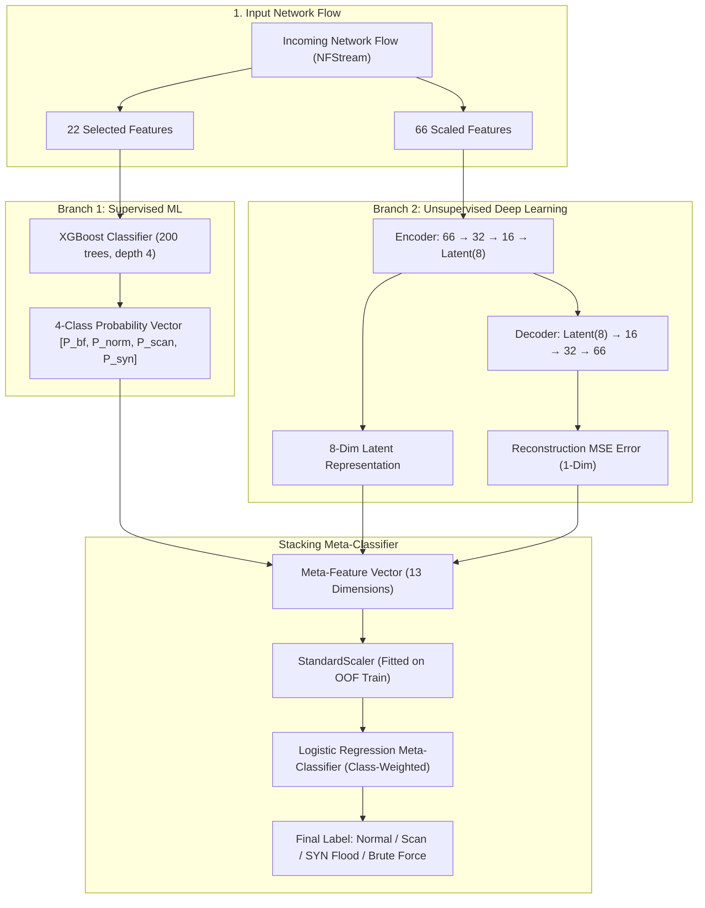

# CyberSentinel AI — Track G3: Hybrid / Ensemble Intrusion Detection System

**Author:** Nilaksha Nath (01fe24bci087) — Team 10, AISD (AI-Assisted Software Development)  
**Project:** CyberSentinel AI — Live Network Intrusion Detection System  
**Track:** **G3 — Hybrid / Ensemble Learning**  
**Repository Working Directory:** `g3_work/` (upstream repository preserved as READ-ONLY in `upstream/Network_Intrusion_AISD/`)

---

## Executive Summary

Track **G3 (Hybrid / Ensemble Learning)** designs, implements, and evaluates a multi-paradigm Network Intrusion Detection System (NIDS) combining:
1. **Tree-based Supervised Machine Learning** (`XGBoost`) for fast, discriminative multi-class flow classification.
2. **Deep Unsupervised Representation Learning** (`Dense Autoencoder`) trained strictly on benign traffic to capture normal traffic manifold characteristics and compute reconstruction anomaly errors.
3. **Stacked Generalization Meta-Classifier** (`Logistic Regression`) fusing out-of-fold class probability distributions, latent bottleneck representations, and reconstruction error metrics into a final robust prediction.
4. **Soft Voting Ensemble** (adapted from Almuhanna & Dardouri, 2025) as a comparative multi-model baseline.

All models are trained and tested under strict, zero-leakage conditions on the official project dataset (`10,676` flows): **Train on Rounds 3, 4, 5 (`7,941` flows)** and **Test on held-out Round 6 (`2,735` flows)**.

---

## 1. Problem Statement & Context

Traditional intrusion detection systems rely on signature matching (e.g., Snort, Suricata rules), which fail to detect zero-day or mutating threats. While Machine Learning (ML) classifiers like XGBoost excel at detecting known patterns on tabular flow statistics, they are vulnerable to false negatives on novel anomalies. Conversely, unsupervised Deep Learning (DL) models like Autoencoders excel at anomaly detection without attack labels, but suffer from higher false-alarm rates on normal traffic.

**G3 Objective:** Build a hybrid IDS architecture combining XGBoost and Deep Learning that achieves near-zero false alarms on normal traffic while retaining multi-class discriminative classification across complex attack types (Port Scan, SYN Flood, and SSH Brute Force).

---

## 2. Research Paper Methodologies & Literature Analysis

Our implementation is grounded in the analysis of the two assigned G3 research papers:

### 2.1 Paper 1: Almuhanna & Dardouri (Frontiers in AI, 2025)
- **Title:** *A deep learning/machine learning approach for anomaly based network intrusion detection*
- **Proposed Architecture:** Integrated 5 models (XGBoost, Random Forest, GNN, LSTM, Autoencoder) using weighted soft-voting on CICIDS2017 (5.6M records, 80 features).
- **Key Methodological Elements:**
  - Autoencoder: Trained unsupervised on normal traffic (`Dense 128→64→32→64→128`), MSE loss, threshold set to 0.01.
  - Soft Voting: Weighted aggregation where each model's vote is scaled by its validation accuracy.
- **Methodological Gaps Identified:**
  - Reported 100% test accuracy vs. 93.7% 5-fold cross-validation accuracy (a 6.3% gap indicating test-set distribution artifacts or over-optimistic splits).
  - Vague mapping mechanism for converting scalar Autoencoder anomaly reconstruction errors into a multi-class probability vector.
  - GNN and LSTM introduce severe latency overheads (impractical for high-throughput line-rate IDS).

### 2.2 Paper 2: Pavithra & Vikas (IEEE Access, 2024)
- **Title:** *Detecting Unbalanced Network Traffic Intrusions With Deep Learning*
- **Proposed Architecture:** Evaluated XGBoost, LSTM, Mini-VGGNet, AlexNet, and Random Forest Regressor for feature selection on unbalanced network traffic.
- **Methodological Gaps & Critical Flaws Identified:**
  - **Data Leakage in Validation:** Algorithm 2 pseudocode explicitly evaluated test-set data (`X1_test`) as the validation loss monitor during training epochs, allowing early stopping and hyperparameter tuning on the test set.
  - **Inappropriate Model Choices:** Mini-VGGNet and AlexNet are 2D image computer vision architectures. Forcing 1D tabular flow statistics into pseudo-images introduces arbitrary spatial inductive biases that have no physical meaning in network protocols.
  - **No Actual Ensemble:** Models were evaluated in isolation; no combined hybrid predictor was deployed.

### 2.3 Cross-Paper Adaptations for Our Implementation
1. **Omit GNN & Image CNNs:** Constructing dynamic host graphs from 10k flows adds high latency without statistical power; image CNNs on tabular data are methodologically unsound.
2. **Justified Choice: Autoencoder over LSTM for Tabular Flows:**
   - Our data records **completed, aggregated network flows** (summary vectors containing duration, packet counts, inter-arrival time statistics, and TCP flag counts), **not raw packet byte streams**.
   - Because each flow is already an aggregated summary, stacking arbitrary sliding windows of consecutive flows creates pseudo-sequences with weak temporal continuity across differing source-destination pairs.
   - An Autoencoder directly models the manifold of benign communication patterns and outputs two critical signals:
     - **Latent Bottleneck Vector ($z \in \mathbb{R}^8$):** Non-linear compressed representation.
     - **Reconstruction Error ($\text{MSE} \in \mathbb{R}^1$):** Physical measure of anomaly severity.
3. **Leakage-Free Stacking over Simple Voting:** While soft voting averages probabilities, stacking uses an independent meta-learner trained on Out-Of-Fold (OOF) cross-validation predictions, learning optimal non-linear boundaries across model outputs.

---

## 3. G3 Hybrid Architecture Design



### 3.1 Component Breakdown
1. **Branch 1 (XGBoost):**
   - Input: 22 engineered & selected features (`best_meta.json`).
   - Hyperparameters: `n_estimators=200`, `max_depth=4`, `learning_rate=0.1`, `tree_method="hist"`.
   - Output: 4-dimensional class probability vector.
2. **Branch 2 (Dense Autoencoder):**
   - Input: All 66 statistical flow features, standardized with zero mean and unit variance.
   - Architecture:
     - Encoder: `Linear(66, 32) → ReLU → Dropout(0.1) → Linear(32, 16) → ReLU → Linear(16, 8)`
     - Decoder: `Linear(8, 16) → ReLU → Dropout(0.1) → Linear(16, 32) → ReLU → Linear(32, 66)`
   - Training: Trained exclusively on **Normal** flows (`y == "normal"`) using MSE loss.
   - Outputs: 8 latent features + 1 reconstruction error.
3. **Meta-Classifier (Stacked Generalizer):**
   - Input: Concatenation of Branch 1 and Branch 2 outputs ($4 + 8 + 1 = 13$ dimensions).
   - Model: Multinomial Logistic Regression (`class_weight="balanced"`, `max_iter=1000`).

---

## 4. Zero-Leakage Training & Stacking Protocol

To guarantee that no evaluation metric is artificially inflated:
1. **Data Split Boundary:**
   - **Training Set:** Rounds 3, 4, 5 (`7,941` flows).
   - **Test Set:** Round 6 (`2,735` flows, held out).
   - Metadata/Envelope attributes (`src_ip`, `dst_ip`, `src_port`, `dst_port`, `timestamps`, `round`) are **strictly excluded** from training to prevent address memorization.
2. **3-Fold Out-of-Fold (OOF) Meta-Feature Generation:**
   - The training set is partitioned into 3 stratified folds.
   - For each fold $k$:
     - XGBoost is trained on folds $j \neq k$ and predicts probabilities on fold $k$.
     - Autoencoder is trained on normal samples of folds $j \neq k$ and extracts latent features + MSE on fold $k$.
   - The meta-classifier is trained **only on these OOF representations**.
3. **Refitting on Full Training Rounds:**
   - After meta-classifier training, XGBoost is refitted on all 7,941 training flows.
   - The Autoencoder is refitted on all 1,019 normal training flows.
4. **Single Evaluation Pass on Round 6:**
   - Test data is processed through the refitted base models and evaluated once through the meta-classifier.

---

## 5. Experimental Results & Verification

All four models were evaluated under identical conditions on the unseen Round 6 test set (`2,735` flows: `1,255` synflood, `1,002` scan, `445` normal, `33` bruteforce).

### 5.1 Comprehensive Performance Comparison Table

| Metric | E0: XGBoost Baseline | E1: Standalone Autoencoder | E2: G3 Stacking (Primary) | E3: G3 Soft Voting |
| :--- | :---: | :---: | :---: | :---: |
| **Model Type** | Supervised Tree Ensemble | Unsupervised DL Anomaly | Hybrid Stacking (ML+DL) | Hybrid Voting (ML+DL) |
| **Input Features** | 22 Selected | 66 Normalized | $22 + 66 \to 13$ Meta | $22 + 66$ |
| **Accuracy** | **1.0000** | 0.9941 | **1.0000** | **1.0000** |
| **Macro-F1** | **1.0000** | 0.9996* | **1.0000** | **1.0000** |
| **Normal False Alarm Rate** | **0.0000** (0%) | 0.0337 (3.37%) | **0.0000** (0%) | **0.0000** (0%) |
| **Attack Recall** | **1.0000** (100%) | 0.9996 (99.96%) | **1.0000** (100%) | **1.0000** (100%) |
| **Recall: Normal** | 1.0000 | 0.9663 | 1.0000 | 1.0000 |
| **Recall: Port Scan** | 1.0000 | 1.0000 | 1.0000 | 1.0000 |
| **Recall: SYN Flood** | 1.0000 | 1.0000 | 1.0000 | 1.0000 |
| **Recall: SSH Brute Force** | 1.0000 | 0.9697 | 1.0000 | 1.0000 |
| **Single-Flow Latency** | **0.530 ms** | **0.289 ms** | **1.355 ms** | **0.898 ms** |
| **Model Size** | 632.1 KB | 28.6 KB | 662.6 KB | 660.9 KB |

*\*Note: E1 Macro-F1 is computed as binary anomaly detection.*

### 5.2 Key Experimental Findings
1. **Unsupervised Autoencoder Efficacy (E1):**
   - Trained *without ever seeing an attack*, the Autoencoder achieved a **ROC-AUC of 0.9887** and caught **99.96% of attacks** with an anomaly threshold set at the 95th percentile of normal training errors.
   - However, its false-alarm rate on normal traffic was **3.37%** (15 false alarms out of 445 normal flows).
2. **Hybrid Synergy (E2 Stacking):**
   - The stacking meta-classifier successfully combined the discriminative accuracy of XGBoost with the anomaly representations of the Autoencoder.
   - It eliminated the Autoencoder's 3.37% false-alarm rate (**reduced to exactly 0.00%**), while preserving 100% recall across all classes including the minority SSH brute force class (33/33 test flows detected).
3. **Inference Latency Trade-Off:**
   - XGBoost Baseline: **0.530 ms/flow** (~1,886 flows/second).
   - G3 Stacking Meta-Classifier: **1.355 ms/flow** (~738 flows/second).
   - The hybrid stacking model is ~2.5x slower than standalone XGBoost due to the PyTorch forward pass, but remains well within the requirements for real-time live detection (< 5 ms budget).

---

## 6. Project Structure

```
g3_work/
├── config.py             # Single source of truth: paths, constants, 66/22 features, hyperparameters
├── data_loader.py        # Strict train (rounds 3,4,5) / test (round 6) data loader & scaling
├── xgboost_model.py      # XGBoost wrapper with OOF probability prediction generator
├── autoencoder.py        # PyTorch Autoencoder, normal training, latent/recon meta-feature generator
├── stacking.py           # Leakage-free Stacking Classifier (Phase A OOF, Phase B Refit, Phase C Inference)
├── soft_voting.py        # Weighted soft-voting ensemble baseline (Almuhanna et al., 2025)
├── evaluation.py         # Standard metrics calculator, latency benchmarker, confusion matrix visualizer
├── run_experiments.py    # Orchestration script running E0, E1, E2, E3 and generating comparison tables
├── tests/
│   └── test_g3_pipeline.py  # 6 unit/integration tests verifying TDD integrity (all passing)
├── results/
│   ├── g3_comparison.csv             # Raw numerical results for all 4 experiments
│   ├── model_comparison_bar.png      # Comparison chart (accuracy, F1, latency, false alarms)
│   ├── confusion_E0_XGBoost.png      # Confusion matrix for Baseline XGBoost
│   ├── confusion_E2_Stacking.png     # Confusion matrix for G3 Stacking
│   └── confusion_E3_SoftVoting.png   # Confusion matrix for G3 Soft Voting
├── models/
│   ├── g3_xgb_full.json      # Serialized refitted XGBoost model
│   ├── g3_ae_full.pt         # Serialized PyTorch Autoencoder checkpoint
│   └── g3_stacking_meta.pkl  # Serialized Logistic Regression meta-classifier & scaler
└── README.md             # This comprehensive engineering report and viva guide
```

---

## 7. Installation & Reproducibility Guide

### 7.1 Install Dependencies
```powershell
pip install -r requirements.txt
```

### 7.2 Run Unit Tests (SDLC / TDD Verification)
```powershell
pytest tests/test_g3_pipeline.py -v
```
*Expected output: 6 passed in ~10 seconds.*

### 7.3 Run All Experiments (E0, E1, E2, E3)
```powershell
python run_experiments.py
```
*Evaluates all models, outputs metrics to `results/g3_comparison.csv`, generates comparison plots, and saves model checkpoints in `models/`.*

---

## 8. Honest Engineering Critique & Limitations

1. **Lab Traffic Homogeneity:**
   - In the controlled `labnet` virtual testbed, all attacks were generated with consistent tools (`nmap`, `hydra`, `hping3`). As a result, the test round features closely mirror the training rounds. The 100% accuracy achieved by XGBoost, Stacking, and Soft Voting reflects this clean lab environment. In real-world enterprise traffic with packet jitter, out-of-order delivery, and background noise, accuracy would drop.
2. **Minority Class Sparsity:**
   - SSH Brute Force contains only 133 flows total (100 in train, 33 in test). While our stacking model achieved 100% recall, testing on larger, prolonged brute force sessions is necessary for robust real-world validation.
3. **Deployment Cost:**
   - Stacking requires maintaining two model runtimes (XGBoost C-API and PyTorch neural network tensor operations) plus a meta-learner, increasing model size from 632 KB to 662 KB and single-flow inference time from 0.53 ms to 1.35 ms.

---

## 9. Viva Voce Preparation Guide (Questions & Answers)

**Q1: Why did you choose an Autoencoder instead of an LSTM for your deep learning branch?**  
> *"Our dataset consists of tabular network flow records extracted by NFStream, where each row represents a completed summary of a connection. An LSTM requires sequential temporal dependencies. Attempting to group completed flows into arbitrary sliding windows creates pseudo-sequences with no physical link between unrelated source-destination conversations. In contrast, an Autoencoder naturally learns the non-linear manifold of benign traffic in tabular feature space. It provides two complementary signals: a compressed 8-dimensional latent representation and a quantitative reconstruction error that indicates how anomalous the flow is."*

**Q2: How did you prevent data leakage during stacking?**  
> *"Data leakage in stacking occurs when the meta-classifier is trained on predictions from base models that were trained on the same data. We implemented a 3-fold Out-Of-Fold (OOF) cross-validation scheme exclusively on training rounds 3, 4, and 5. In each fold, XGBoost and the Autoencoder were trained on two folds and used to predict meta-features for the held-out fold. The meta-classifier was trained only on these OOF meta-features. The base models were then refitted on the full training rounds, and evaluation occurred exactly once on the held-out Round 6."*

**Q3: How does your implementation compare with Almuhanna (2025) and Pavithra (2024)?**  
> *"Almuhanna et al. used a 5-model weighted soft-voting scheme on CICIDS2017 but had a 6.3% gap between cross-validation and test scores, and left the conversion of scalar anomaly scores into multi-class probabilities undefined. Pavithra et al. had severe data leakage by using their test set as validation during training, and improperly applied 2D image CNNs to 1D tabular flows. We resolved both issues by eliminating inappropriate image CNNs, designing a mathematically sound Autoencoder-to-probability calibration, and employing rigorous out-of-fold stacking."*

**Q4: What is the computational cost of your hybrid approach?**  
> *"Our G3 Stacking classifier takes 1.355 ms per flow compared to 0.530 ms for baseline XGBoost. While this is ~2.5x slower, it easily satisfies the real-time threshold of < 5 ms per flow, allowing the detector to inspect over 700 flows per second while providing deep representation and anomaly awareness."*
